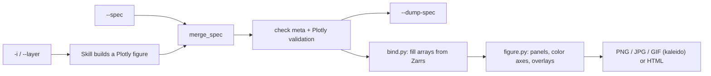

# Plotting skills

How the figure stack works. Agent how-tos live in each skill's
[`SKILL.md`](../skills/plot/SKILL.md); this page is the design.

## The spec is a Plotly figure

Every skill's `--spec` is a standard Plotly figure, `{"data": [...], "layout": {...}}`
(<https://plotly.com/python/reference/>). Plotly validates every key except
`meta`, where the weather-skills bindings live:

- `data[].meta` says what a trace draws: its input and variable (`source`),
  how its arrays are filled (`bind`), which dim makes panels (`facet`), how a
  series fans out (`along`, `band`), and its class palette (`palette`).
- `layout.meta` holds figure-wide settings: `inputs`, `geo` (bbox, mask,
  point), `overlays` and `export`.

`spec.check_meta` checks the `meta` blocks and lists the allowed keys on any
error.



## Plotting computes as little as possible

The plotter selects and draws. Derived fields come from data skills upstream.

- In the plotter: selection (`isel` / `sel`, bbox, mask), display units and
  labels, color classes, panel layout, and drawing geometry (arrow segments,
  overlay simplification).
- In a data skill: averages, rate-to-total conversion (`convert-to-totals`),
  smoothing, thresholds, anomalies, feature detection (highs and lows, fronts,
  tracks), and other statistics.
- Use standard Plotly keys before adding a `meta` key or bind.

## Merging

`merge_spec(base, overlay)` deep-merges `--spec` onto the figure the skill
built, and the user wins:

- `data[]` merges by `uid`, else by position. A new `uid` adds a plain Plotly
  trace (city markers, a box outline).
- `layout.annotations`, `shapes` and `images` merge by `name`.
- Everything else is a recursive dict merge.

`--dump-spec` prints the merged spec before any data is loaded. It has no
arrays, and `layout.meta.inputs` keeps the file paths, so it replays without
file flags.

## Binding (`bind.py`)

| `meta.bind` | Plotly type | Fills |
| --- | --- | --- |
| `field` | heatmap, contour | `z` on lon/lat; one panel per `facet` value (default `step`/`time`) |
| `speed` | heatmap, contour | wind speed from u/v |
| `arrows` | scatter | arrow polylines from u/v plus a 10 m/s key |
| `points` | scatter | station markers colored by value |
| `geojson` | scatter | boundary lines from a GeoJSON file, on every panel |
| `series` | scatter, bar | one line along time, or an `along` fan / `band` |
| `xy` | scatter | one variable against another (`meta.x` / `meta.y`) |
| `samples` | box, scatter | all samples per step (box) or their mean (scatter) |
| `windrose` | barpolar | one trace per speed class, frequency in percent |

The trace type picks the default bind (`heatmap` → `field`, `barpolar` →
`windrose`, …). A size-1 dim is squeezed; any other dim left after `isel` /
`sel` / `facet` / `along` is an error that names the fix. The only means the
plotter draws are a band's mean line and the `samples` scatter. Every other
average is made upstream with `summarize-dim` or `aggregate-temporal`.
Units go through `to_standard_units`, except a precip rate already in mm per some
time step (mm/h from `unit-convert`), which keeps its units.

## Assembly (`figure.py`, `layout.py`)

- **Panels.** Map traces on the same axes are layers; traces on `x2`, `x3`, …
  are side-by-side panels, each on its own lat/lon grid. A faceted trace
  expands into one panel per value, and static layers repeat on every panel.
- **Map axes.** Equal-degree lon/lat axes (`scaleanchor`), not Plotly geo
  subplots, which cannot hold a heatmap. Each panel is sized from its lon/lat
  aspect. Room for titles, ticks and colorbars is a starting size in multiples
  of the font size, and Plotly grows the margins when labels need more.
- **Color axes.** Each color-scaled trace gets a `coloraxis`. Traces of the
  same quantity share one, and trace-level `colorscale`, `zmin`/`zmax` and
  `colorbar` are lifted onto it.
- **Class palettes.** Precipitation, SPI and percent-of-normal fields get the
  CHC class palettes; CF flag fields get one class per flag. Values are drawn
  as class indices on a stepped colorscale, and the raw values stay in
  `customdata` for hover. User limits turn a class palette into a
  continuous scale.
- **Overlays.** Natural Earth coastline, borders, lakes, rivers and admin-1,
  as line traces at a scale chosen from the map span.
- **Defaults.** Titles, colorbar labels, sizes and the theme fill only what
  the user leaves unset.

## Output

The `-o` suffix picks the format: `.png` or `.jpg` (kaleido, needs Chrome) or
`.html` (self-contained, interactive), or `.gif` for `--animate` (each frame
drawn by kaleido, joined by Pillow). Images print a pixel `plot hash` and a
`data: not null | NULL` line. Provenance is embedded in PNG `tEXt` chunks, the
GIF comment block, or an HTML `<meta>` tag.

```python
from weather_skills_plotting import compile, export

fig = compile(spec, {"0": dataset})  # plotly.graph_objects.Figure
export(fig, "out.png", datasets={"0": dataset})
```
