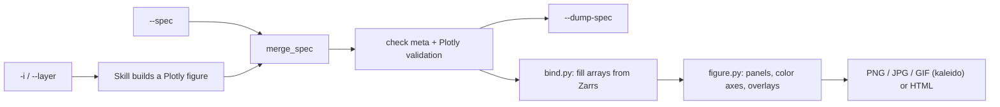

# Plotting skills

How the figure stack works. Agent how-tos live in each skill's
[`SKILL.md`](../skills/plot/SKILL.md); this page is the design.

## The spec is a Plotly figure

Every skill's `--spec` is a standard Plotly figure, `{"data": [...], "layout": {...}}`
(<https://plotly.com/python/reference/>). Plotly validates every key except
`meta`, where the weather-skills bindings live:

- `data[].meta` says what a trace draws: its input and selection (`source`),
  the variable or coordinate that fills each Plotly attribute (`x`, `y`, `z`,
  `marker.color`) or a preset that computes its arrays (`bind`), which dim
  makes panels (`facet`), how a line fans out (`along`, `band`), and its class
  palette (`palette`).
- `layout.meta` holds figure-wide settings: `inputs`, `geo` (bbox, mask,
  point), `overlays`, `export` and `animation` (plus the `version` / `skill`
  stamps a dumped spec carries).

`spec.check_meta` checks the `meta` blocks and lists the allowed keys on any
error.



## Plotting computes as little as possible

The plotter selects and draws. Derived fields come from data skills upstream.

- In the plotter: selection (`isel` / `sel`, bbox, mask), display units and
  labels, color classes, panel layout, and drawing geometry (arrow segments,
  overlay simplification).
- In a data skill: averages, rate-to-total conversion (`convert-to-totals`),
  smoothing, thresholds, anomalies, feature detection (highs and lows, fronts,
  tracks), and other statistics.
- Use standard Plotly keys before adding a `meta` key or preset.

## Merging

`merge_spec(base, overlay)` deep-merges `--spec` onto the figure the skill
built; the spec wins.

- `data[]` merges by `uid`, else by position. Each input's trace is built with
  its mapping written out (`"z": "precip"`, `"x": "time"`, …), so a spec trace
  with that uid only needs the keys it changes.
- A spec trace with a new `uid` that reads data (`meta.x` / `y` / `z` /
  `marker.color`, or a non-GeoJSON `meta.source`) replaces the `-i` inputs'
  traces, except those the spec also names by uid. Outlines and `--layer`
  traces are always kept. A new `uid` that reads no data adds a plain Plotly
  trace (city markers, a box outline).
- `layout.annotations`, `shapes` and `images` merge by `name`; everything else
  is a recursive dict merge.

`--dump-spec` prints the merged spec before any data is loaded. It has no
arrays, and `layout.meta.inputs` keeps the file paths, so it replays without
file flags.

## Binding (`bind.py`)

A trace's `meta` names what fills each Plotly attribute:

| `meta` | Plotly type | Draws |
| --- | --- | --- |
| `z` | heatmap, contour | a lon/lat grid; one panel per `facet` value (default `step`/`time`). With `x` / `y` naming two other dims of `z`: a cross-section chart, pressure axes 1000 hPa at the bottom |
| `x` longitude, `y` latitude | scatter | stations, colored by `marker.color` when set |
| `x` time or step, `y` | scatter, bar | one line along it, or an `along` fan / `band` |
| `x`, `y` two variables | scatter, bar | one point per shared position |

`meta.bind` names a preset that computes its arrays instead:

| `meta.bind` | Plotly type | Fills |
| --- | --- | --- |
| `speed` | heatmap, contour | wind speed from u/v |
| `arrows` | scatter | arrow polylines from u/v plus a 10 m/s key |
| `geojson` | scatter | boundary lines from a GeoJSON file, on every panel |
| `samples` | box, scatter | all samples per step (box) or their mean (scatter) |
| `windrose` | barpolar | one trace per speed class, frequency in percent |

A trace with `meta.source` but no mapping or preset is an error. A size-1 dim
is squeezed; any other dim left after `isel` / `sel` / `facet` / `along` is an
error that names the fix. The plotter averages nothing except a band's mean
line and the `samples` scatter, and draws values in the file's own units.

## Assembly (`figure.py`, `layout.py`)

- **Panels.** Map traces on the same axes are layers; traces on `x2`, `x3`, …
  are side-by-side panels, each on its own lat/lon grid. A faceted trace
  expands into one panel per value, and static layers repeat on every panel.
- **Grid placement.** Panels fill the grid in axis order (`xy`, `x2y2`, …),
  left to right, then row by row. Plotly's `layout.grid.subplots` places them
  instead: rows of cells, each naming a map's axis pair or `""` for none. The
  plotter turns it into an explicit `domain` per axis and drops `grid`, so
  every trace on a map's axes, outlines included, moves with it.
- **Ticks and titles.** Panels showing the same lon/lat window keep tick
  labels on the outer edge only, and the gaps shrink to match. A side-by-side
  title too wide for its column breaks onto two lines.
- **Map axes.** Equal-degree lon/lat axes (`scaleanchor`), not Plotly geo
  subplots, which cannot hold a heatmap. Each panel is sized from its lon/lat
  aspect. Room for titles, ticks and colorbars is a starting size in multiples
  of the font size, and Plotly grows the margins when labels need more.
- **Color axes.** Each color-scaled trace gets a `coloraxis`. Traces of the
  same quantity share one, and trace-level `colorscale`, `zmin`/`zmax` and
  `colorbar` are lifted onto it.
- **Class palettes.** Precipitation, SPI and percent-of-normal fields get the
  CHC class palettes; CF flag fields get one class per flag. Values are drawn
  as class indices on a stepped colorscale, and the raw values stay in
  `customdata` for hover. User limits turn a class palette into a
  continuous scale.
- **Overlays.** Natural Earth coastline, borders (disputed lines dashed),
  lakes, rivers and admin-1, as line traces at a scale chosen from the map span.
- **Defaults.** Titles, colorbar labels, sizes and the theme fill only what
  the user leaves unset.

## Output

The `-o` suffix picks the format: `.png`, `.jpg`, `.pdf` or `.svg` (kaleido,
needs Chrome), `.html` (self-contained, interactive), or `.gif` for `--animate`
(each frame drawn by kaleido, joined by Pillow). Images print a `plot hash` and
a `data: not null | NULL` line; the hash is of the pixels for PNG and JPG, and
of the figure JSON for PDF and SVG, so it does not match across those formats.
Provenance is embedded in the image's own metadata (PNG `tEXt` chunks, JPG,
PDF, SVG, the GIF comment block) or an HTML `<meta>` tag.

```python
from weather_skills_plotting import compile, export

fig = compile(spec, {"0": dataset})  # plotly.graph_objects.Figure
export(fig, "out.png", datasets={"0": dataset})
```
