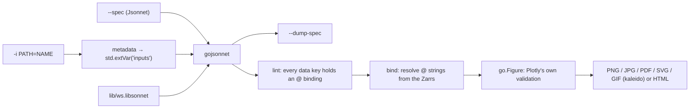

# Plotting skills

How the figure stack works. The agent how-to is the skill's
[`SKILL.md`](../skills/plot/SKILL.md); runnable examples are in
[`skills/plot/recipes/`](../skills/plot/recipes/). This page is the design.

## How a figure is made: spec → render → lint → bind

1. **Spec.** Jsonnet that evaluates to a Plotly figure, with an `@` reference
   wherever data goes. Inputs are named on the command line.
2. **Render.** `spec.py` evaluates the Jsonnet (gojsonnet) with
   `std.extVar('inputs')`, giving plain Plotly JSON with the references still
   unbound (what `--dump-spec` prints).
3. **Lint.** `lint.py` checks that JSON against Plotly's attribute schema
   before any data is read: every key that can put data on the chart holds an
   `@` binding (details below).
4. **Bind.** `refs.py` resolves each reference from its input, checking the
   operations and shapes; then `go.Figure` validates the result and it is
   exported.

## The spec is Jsonnet that evaluates to a Plotly figure

The agent writes Jsonnet whose value is a standard Plotly figure,
`{"data": [...], "layout": {...}, "frames": [...]}`
(<https://plotly.com/python/reference/>). Jsonnet adds variables, functions,
loops and imports to JSON, so a 50-member plume or a 4 × 5 grid of maps is a
few lines, and long strings (selections, color tables) are written once.

Where Plotly expects data, the spec holds a **reference**: a string that starts
with `@` and names an input, `'@OBS.precip.isel(time=0)'`. Inputs are named on
the command line, `-i rain.zarr=OBS`. There is no other binding: no `meta`
keys, no inferred plot types, no layers or modes. What the spec says is what
Plotly draws.

## Metadata in Jsonnet, values in references

`std.extVar('inputs')` gives each input's dims, variables (dims, units,
long_name), small 1-D coordinates, attributes and bbox, all read from Zarr
metadata without loading data. The spec uses it for loop bounds, titles and
map windows. Anything that needs data values (arrays, a maximum for `zmax`)
is a reference, resolved after evaluation. Jsonnet never sees values.

## References select, they don't compute

`refs.py` parses each reference with `ast.parse(mode="eval")` and walks it
against a fixed table; nothing is `eval`'d. Each method has one job:

| Job | Methods |
| --- | --- |
| Select | `isel`, `sel` (with `method="nearest"`), `slice()`, `dropna` (drop all-NaN entries along a dim), `NE…clip(n, w, s, e)` |
| Reshape | `squeeze`, `transpose`, `flat` (a 2-D selection as one value per cell), `lon360` / `lon180` (a field across the dateline or prime meridian in one piece) |
| Label | `.dt.<part>`, `.dt.strftime`, `.attrs.<name>` |
| Display limit | `min`, `max`, `quantile`: whole array only, and only in `zmin`, `zmax`, `zmid`, `cmin`, `cmax`, `cmid`, an axis `range` or `tickvals` |
| Pixel size | `+ − × ÷` by a number or `@const`, data on one side only, and only in `marker.size`, `marker.standoff`, `marker.line.width`, `textfont.size`: how big a marker is on screen (arrows by wind speed, dots by rainfall), the way Plotly's `sizeref` scales `marker.size` |

So every value drawn is a value stored in an input; only the on-screen size of a marker may be scaled. Arithmetic on data, averages,
smoothing, regridding and masking are refused with the data skill that does
the job (`summarize-dim`, `aggregate-temporal`, `unit-convert`, `difference`,
`coarsen` / `downscale`, `clip-region`). The recipe tests check the
invariant: each recipe's resolved arrays hold only values stored in its
inputs.

## Lint before binding: data only through references

The flow is spec → render → lint → bind. `lint.py` walks the rendered figure
against Plotly's own attribute schema (`data_keys.py` reads
`plotly/validators/_validators.json` and sorts every leaf key) and raises,
listing every problem, unless each key that can put data on the chart holds
an `@` binding:

- data keys (`data_array` in the schema: `x`, `z`, `dimensions[].values`, …);
- per-point keys (`arrayOk`: `marker.color`, `text`, …) when given a list;
- generator keys (`x0` / `dx`, `base`, error-bar `value`) and error bars that
  would fall back to Plotly's default ±10;
- keys the schema types loosely but that carry data (`geojson`, an image
  `source`, `selectedpoints`);
- shapes, annotations, images and selections on a data axis, menu and slider
  `args`, frames and templates;
- keys Plotly doesn't define, which can't be checked.

Constants on a data axis come in through `--const NAME=VALUE` as
`@const.NAME`, so even a threshold line is a recorded input rather than a
number in the spec. `python -m weather_skills_plotting.data_keys` writes the
key listing as JSON for a Plotly upgrade to be reviewed.

Shape rules are the only other logic: `z` must be 2-D (a lat/lon grid is
written with rows as latitudes), `customdata` 1-D or 2-D, everything else one
value or 1-D. A leftover dim is an error naming it.

## `ws.libsonnet`: conveniences in Jsonnet, not Python

Defaults (map axes, panel grids, base map, palettes,
animation controls) are Jsonnet functions that return plain Plotly JSON. The
agent can read them and override any part with `+`.

- **Map axes.** Equal-degree lon/lat axes (`scaleanchor`), not Plotly geo
  subplots, which cannot hold a heatmap. `ws.map` sizes the canvas from the
  bbox aspect; `ws.grid` lays out panels row by row with tick labels on the
  outer edge.
- **Base map.** `ws.basemap` returns line traces whose `x` / `y` reference the
  built-in `NE` input (Natural Earth via cartopy, clipped to the bbox, scale
  from the map span). If borders or coastline can't be fetched, the country
  outlines bundled with core stand in.
- **Palettes.** `ws.palettes` holds the CHC class palettes and the verify
  palettes as `{colors, bounds}` (and `labels` where classes have names).
  `ws.stepped` turns one into a coloraxis whose colors step at the bounds, so
  the map colors are exact without changing the data. Plotly's colorbar is
  linear in value, which would make the 0–1–2 mm classes slivers, so
  `ws.classBar` hides it and draws its own from layout shapes and annotations:
  one equal-height band per class, labelled at the bounds, with under / over
  triangles.
- **Animation.** Standard Plotly `frames`; `ws.player` adds play / pause and a
  slider. A `.gif` output draws each frame with kaleido and joins them on one
  shared palette, at the play button's frame duration. Scatter traces that the
  frames replace are `scattergl`: Plotly redraws an SVG `scatter` in a frame in a
  way that drops the heatmap from every other paint, and the map flashes.

## Output

The `-o` suffix picks the format. Images print a `plot hash` and a
`data: not null | NULL` line over the plotted traces (base-map lines from
`ws.basemap` are left out). Provenance is embedded in the file,
with the evaluated spec as the `spec` argument: it replays with `--spec` and
the same `-i` inputs.
